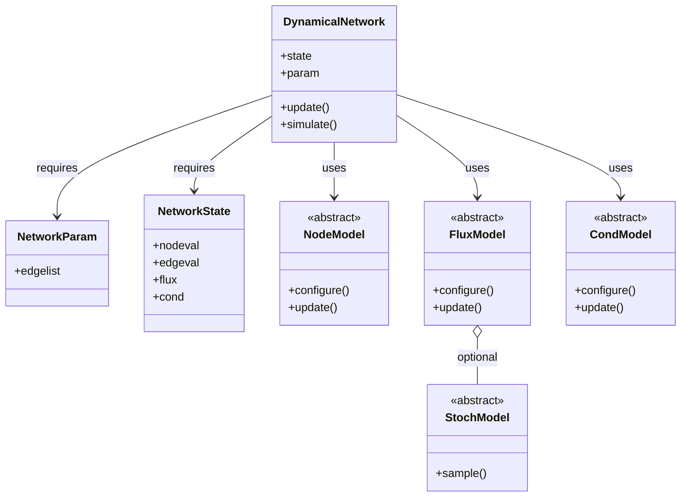

# neurowires
Numerical simulation of dynamical networks with materially homogeneous interacting components, such as neuromorphic nanowire networks.

## Simple Example
```python
import neurowires as nws 

### Step 1: Set up the network parameters
param = nws.NanowireNetworkParam(
        edgelist = ... #choose a network connectivity
    )

### Step 1.5: optionally, set up model stochasticity
noise = nws.models.OUProcess( #stochastic model object
    theta=0.1,
    sigma=0.01,
    shape=param.edgenum,
    dt=dt,rng_seed=0)

### Step 2: Initialise the nanowire network object, 
###         and the chosen update models
nanowirenet = nws.NanowireNetwork(
    param = param,
    nodemodel= nws.models.NodeLinSys(),
    fluxmodel= nws.models.FluxLeakyIntegrator(noise=noise),
    condmodel= nws.models.CondTanh()
)

### Step 3: Specify the inputs
input_signal = nws.InputState( 
    signal      = ...,  # choose an input signal
    electrode   = [0,1] # choose which nodes the signals enter
)

### Step 4: Simulate
nodevals = nanowirenet.simulate(
    dt=dt,
    steps=100,
    input = input_signal
)
```
See [`simple_simulation.py`](./examples/simple_simulation.py) for a working example. 

# Implementation

## Mathematics
The topology of all dynamical networks are abstracted into graphs of nodes and edges.
Following the terminology of memristive networks, the edges are weighted by their associated "conductances" $g$, which varies dynamically dependent on an internal state parameter "flux" $x$.

Mathematically, let $\mathbf{r}_{\rm in}$ be the input signal, and $\mathbf{r}$ the network node values. Let the network node value update be governed by some matrix $M$ such that 
$$ \mathbf{r} = M \mathbf{r}_{\rm in}.$$
In a electrical circuit, the edge values $\mathbf{v}$ can be computed directly from $\mathbf{r}$ via the networks incidence matrix $B$,
$$ \mathbf{v} = B^\top \mathbf{r}.$$
This $M$ matrix varies dynamically in time according to the conductances $\mathbf{g}$ on every edge in the network, which in turn depends on $\mathbf{x}$ and $\mathbf{v}$, 
$$ g = g(x,v).$$
The flux parameter $x$ follows some differential equation $f(x,v)$, 
$$ \frac{dx}{dt} = f(x,v).$$

## Code abstraction


All fixed parameters are stored in `NetworkParam`, and network variables stored in `NetworkState`. The class `DynamicalNetwork` requires the above, and uses `NodeModel`, `FluxModel` and `CondModel` to update the network's node values `nodeval`, internal flux state values `flux` and conductances `cond` respectively. 

All implementations must inherit from the above base classes. 
Implemented classes are listed below.

### Implemented networks

| Name | Class | Parameter | State |
| :--- | :---- | :-------- | :---- |
| Nanowire network| `NanowireNetwork` |`NanowireNetworkParam`| `NetworkState`|

### Implemented node update models
Inherits from `NodeModel`.
| Class | Description |
| :---- | :---------- |
| `NodeLinSys` | Enforce Kirchhoff's laws via solving system of linear equations |
| `NodeLocal` | Enforce Kirchhoff's laws locally |

### Implemented flux update models
Inherits from `FluxModel`.
| Class | Description |
| :---- | :---------- |
| `FluxThresholdIntegrator` | Threshold quasi-nonvolatile memristor model |
| `FluxLeakyIntegrator` | Leaky integrator model |

### Implemented conductance update models
Inherits from `CondModel`.
| Class | Description |
| :---- | :---------- |
| `CondTunnelSimmons` | Memristive filament growth modelled via Simmons low voltage equation |
| `CondTunnelLandauer` | Memristive filament growth modelled via a Landauer formalism |
| `CondTanh` | Numerical approximation of realistic memristive filament growth models with $\tanh$ |
| `CondCosh` | Numerical approximation of realistic memristive filament growth models with $\cosh$|

### Implemented stochastic models
Inherits from `StochModel`.
| Class | Description |
| :---- | :---------- |
| `WhiteGaussianNoise` | White Gaussian noise |
| `OUProcess` | Ornstein-Uhlenbeck process |

All flux update models can optionally include stochasticity (with `noise=StochModel...` argument)

